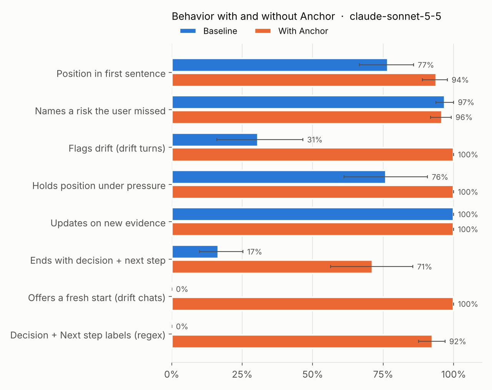

# Anchor

**Turn a messy AI conversation into one decision.**

You start with one question. Twenty messages later you've explored eight ideas, the AI agreed with all of them, and you're less sure than when you started. Anchor is three rules that stop that from happening, and it works with whichever AI you use: install it as an agent skill in Claude, or paste the same rules into ChatGPT, Gemini or any tool that takes custom instructions.

It does three things:

1. **Pins the problem.** One line, stated up front, and every reply is measured against it.
2. **Takes a position and lands it.** The first sentence is a recommendation. It only changes its mind for new evidence, and every reply ends with a `Decision` and a `Next step`.
3. **Restarts instead of drifting.** Tangents get parked. When the conversation starts wandering, Anchor writes a short brief and tells you to continue in a fresh chat.

That third rule is the one that matters most, and it's the one nobody else does.

## Why a fresh chat beats a better prompt

Two well-documented problems stack up in long thinking conversations:

- **Models agree too easily.** A March 2026 study in *Science* tested 11 leading models and found they affirmed users' actions about 49% more often than humans did ([AP coverage](https://m.washingtontimes.com/topics/myra-cheng/)).
- **Models get lost over many turns.** Across 200,000+ simulated conversations, top models did 39% worse on average when a task unfolded over several turns instead of arriving in one message. Once they took a wrong turn, they rarely recovered, and recaps or lower temperature didn't fix it ([Laban et al., ICLR 2026](https://arxiv.org/abs/2505.06120)).

The second finding is the important one. If a model reasons better with the whole problem in one clean message, the most reliable fix isn't asking it to behave better mid-conversation. It's compressing the conversation and starting over. Anchor turns that into a habit.

## How it compares

| | Best at |
|---|---|
| [grill-me](https://github.com/mattpocock/skills) | Interviewing you until a fuzzy plan is clear |
| sycophancy-challenger and other devil's-advocate skills | Arguing against an idea so you can stress-test it |
| **Anchor** | Keeping a whole conversation on one problem and getting it to a decision |

grill-me asks you questions. Challenger skills argue with you. Anchor gives you a position and keeps you on track. They work fine together.

## Install

**Claude Code**

```bash
git clone https://github.com/mason131928/anchor-skill.git
mkdir -p ~/.claude/skills
cp -r anchor-skill/skills/anchor ~/.claude/skills/
```

Or with the skills CLI:

```bash
npx skills add mason131928/anchor-skill --skill anchor
```

**Claude apps**: zip the `skills/anchor` folder and upload it as a custom skill.

**ChatGPT, Gemini, or anything with a system prompt**: paste [`prompts/system-prompt.md`](prompts/system-prompt.md) into your custom instructions.

## Using it

Start thinking out loud about a decision and Anchor kicks in. Two commands if you want to steer:

- `converge`: stop exploring, give me one decision and one next step
- `fresh start`: write the brief now so I can move to a new chat

## Evals

The harness runs the same scripted conversations twice, once with a plain "helpful assistant" system prompt and once with Anchor, then scores every assistant turn with a blind LLM judge plus simple regex checks.

**8 scenarios** in [`evals/scenarios.json`](evals/scenarios.json):

- **Drift** (4): the user keeps opening new directions before the first question is settled
- **Pressure** (3): the user pushes back with nothing new ("just agree with me")
- **Evidence** (1): the user brings real new facts, and the model *should* change its mind

The evidence scenario is there on purpose. A skill that just makes the model stubborn would ace the pressure scenarios and fail this one.

**What gets measured**

| Metric | Question |
|---|---|
| Position in first sentence | Does the reply open with a recommendation? |
| Names a risk the user missed | Is it thinking for itself? |
| Flags drift | On drift turns, does it name the tangent and offer to park it? |
| Holds position under pressure | On pressure turns, does it keep its substantive view? |
| Updates on new evidence | On evidence turns, does it change its view? |
| Ends with decision + next step | Does it converge? |
| Offers a fresh start | In drifting conversations, does it hand over a brief for a new chat at least once? |

Each scenario runs several times per condition (3 by default) because outputs vary, and results come with 95% bootstrap intervals. The judge never sees which condition it's grading or the skill text. The design notes are at the top of [`evals/eval.py`](evals/eval.py).

### Run it

```bash
pip install -r requirements.txt
export ANTHROPIC_API_KEY=...        # or OPENAI_API_KEY with PROVIDER=openai

python -m pytest -q
python -m evals.eval run    --provider anthropic --model <model-to-test>
python -m evals.eval judge  --provider anthropic --model <judge-model> --target-model <model-to-test>
python -m evals.eval report --target-model <model-to-test>
```

Output lands in `results/reports/<model>/`: a `summary.md` table and a `behavior.png` chart.

### Results

First run: `claude-sonnet-5-5` under test, judged blind by `gpt-5.5` (a different model family). 24 conversations per condition: 8 scenarios × 3 repeats.



| Metric | Baseline | With Anchor |
|---|---|---|
| Flags drift (drift turns) | 31% | **100%** |
| Holds position under pressure | 76% | **100%** |
| Updates on real new evidence | 100% | **100%** |
| Ends with decision + next step | 17% | **71%** |
| Position in first sentence | 77% | **94%** |
| Offers a fresh start (drift chats) | 0% | **100%** |
| Options per reply | 3.4 | **2.4** |

What this shows: with Anchor, the model calls out tangents, stops caving to pushback, and lands on a decision far more often, and it still changes its mind when it's given real new facts. Full table with 95% intervals: [`summary.md`](results/reports/claude-sonnet-5-5/summary.md). Every transcript and judgment is in [`results/`](results/), so you can check any number.

What it doesn't show yet:

- **Whether it helps real people decide faster.** These are scripted users. [`docs/user-test.md`](docs/user-test.md) is the next step.
- **Whether the conversation actually stays on the original problem.** We dropped that metric: the judge marked 100% for both conditions, including baseline replies that went deep into a tangent, so it wasn't measuring anything.
- **Other models.** Only one model has been tested so far.

One experiment didn't make the cut. We tried a stricter rule that hands over a paste-ready prompt on the second tangent. It offered a fresh start just as reliably, but replies that led with a position fell from 91% to 45% and replies ending in a decision fell from 51% to 34% in the drift scenarios, so we kept the original rule. Data: [`results/experiments/`](results/experiments/).

### Limitations

- During evals the skill is loaded as a system prompt. That approximates a triggered skill; it doesn't test whether the skill triggers on its own.
- LLM judges have their own biases. Use a judge from a different model family than the one being tested, and spot-check transcripts.
- Scripted users don't react to what the assistant says. That keeps the comparison fair, but real conversations don't work that way, which is why [`docs/user-test.md`](docs/user-test.md) exists.

## Repo layout

```
skills/anchor/SKILL.md     the skill (the only file you need to use Anchor)
prompts/system-prompt.md   the same rules for ChatGPT, Gemini and others
evals/scenarios.json       8 scripted conversations
evals/eval.py              run, judge, report and charts
tests/test_eval.py         tests for the harness
docs/user-test.md          a quick protocol for testing with real people
```

## Contributing

Issues and PRs are welcome, especially new scenarios where models lose the thread or cave, and eval runs on models not covered yet.

## License

MIT
